# SIES Campus Portal — Entity Relationship Diagram (simple)

Core tables only, with their keys and the most important fields. Taken from `database/migrations`.
Supporting tables that stand alone are listed at the end.

```mermaid
erDiagram
    USERS ||--o| STUDENTS : "signs in as"
    USERS ||--o{ CLASS_OFFERINGS : "teaches"
    PROGRAMS ||--o{ STUDENTS : "has"
    PROGRAMS ||--o{ PROGRAM_SUBJECT : "curriculum"
    SUBJECTS ||--o{ PROGRAM_SUBJECT : "belongs to"
    SUBJECTS ||--o{ SUBJECT_PREREQUISITES : "requires"
    ACADEMIC_YEARS ||--o{ TERMS : "has"
    TERMS ||--o{ CLASS_OFFERINGS : "offers"
    SUBJECTS ||--o{ CLASS_OFFERINGS : "taught as"
    CLASS_OFFERINGS ||--|{ CLASS_MEETINGS : "meets on"
    STUDENTS ||--o{ GUARDIANS : "has"
    STUDENTS ||--o{ CREDITED_SUBJECTS : "transferred in"
    SUBJECTS ||--o{ CREDITED_SUBJECTS : "credited as"
    STUDENTS ||--o{ STUDENT_REQUIREMENTS : "submits"
    REQUIREMENTS ||--o{ STUDENT_REQUIREMENTS : "checked as"
    STUDENTS ||--o{ ENROLLMENTS : "requests"
    CLASS_OFFERINGS ||--o{ ENROLLMENTS : "receives"
    CLASS_OFFERINGS ||--o{ ATTENDANCE_SESSIONS : "has a sheet per day"
    ATTENDANCE_SESSIONS ||--|{ ATTENDANCE_RECORDS : "contains"
    STUDENTS ||--o{ ATTENDANCE_RECORDS : "is marked in"
    STUDENTS ||--o{ ABSENCE_EXCUSES : "sends"
    CLASS_OFFERINGS ||--o{ ABSENCE_EXCUSES : "for"

    USERS {
        bigint id PK
        string name
        string email UK
        string role "admin, registrar, teacher, student"
        boolean is_active
    }
    STUDENTS {
        bigint id PK
        bigint user_id FK "nullable, unique"
        bigint program_id FK
        string student_number UK
        string last_name
        string first_name
        tinyint year_level
        string status "active, inactive, graduated, withdrawn"
    }
    GUARDIANS {
        bigint id PK
        bigint student_id FK
        string full_name
        string relationship
        string contact_number
    }
    PROGRAMS {
        bigint id PK
        string code UK
        string name
    }
    SUBJECTS {
        bigint id PK
        string code UK
        string title
        decimal units
        string category "major, minor"
    }
    PROGRAM_SUBJECT {
        bigint program_id FK
        bigint subject_id FK
    }
    CREDITED_SUBJECTS {
        bigint id PK
        bigint student_id FK
        bigint subject_id FK
        string school "where it was passed"
    }
    SUBJECT_PREREQUISITES {
        bigint subject_id FK "the subject"
        bigint prerequisite_id FK "subjects.id, taken first"
    }
    ACADEMIC_YEARS {
        bigint id PK
        string name UK
        date start_date
        date end_date
    }
    TERMS {
        bigint id PK
        bigint academic_year_id FK
        string name
        boolean enrollment_open
        timestamp closed_at
    }
    CLASS_OFFERINGS {
        bigint id PK
        bigint term_id FK
        bigint subject_id FK
        bigint teacher_id FK "users.id"
        string class_code
        string section
        int capacity
        string status "open, closed, cancelled"
    }
    CLASS_MEETINGS {
        bigint id PK
        bigint class_offering_id FK
        tinyint day_of_week
        time start_time
        time end_time
        string room
    }
    ENROLLMENTS {
        bigint id PK
        bigint student_id FK
        bigint class_offering_id FK
        string status "pending, approved, enrolled, rejected, cancelled"
        timestamp enrolled_at
        timestamp dropped_at
    }
    ATTENDANCE_SESSIONS {
        bigint id PK
        bigint class_offering_id FK
        date session_date
        bigint taken_by FK "users.id"
    }
    ATTENDANCE_RECORDS {
        bigint id PK
        bigint attendance_session_id FK
        bigint student_id FK
        string status "present, late, absent, excused"
        string remarks
    }
    REQUIREMENTS {
        bigint id PK
        string name UK
        boolean is_required
    }
    STUDENT_REQUIREMENTS {
        bigint id PK
        bigint student_id FK
        bigint requirement_id FK
        string status "pending, submitted, verified"
    }
    ABSENCE_EXCUSES {
        bigint id PK
        bigint student_id FK
        bigint class_offering_id FK
        date date
        string reason
        string status "pending, accepted, declined"
    }
```

## Rules the database itself enforces

- One student cannot request the same class twice: `enrollments (student_id, class_offering_id)` is unique.
- One attendance sheet per class per day: `attendance_sessions (class_offering_id, session_date)` is unique.
- One mark per student per sheet: `attendance_records (attendance_session_id, student_id)` is unique.
- One excuse letter per student, class and day: `absence_excuses (student_id, class_offering_id, date)` is unique.
- A student account links to at most one student record: `students.user_id` is unique.
- Records with history cannot be deleted while in use (`restrictOnDelete` on students, classes, terms, subjects).

## Supporting tables (not drawn)

| Table | Purpose |
|---|---|
| `audit_logs` | Who did what and when (links to `users`) |
| `non_class_days` | Holidays and suspensions, never counted as absences |
| `settings` | School name, unit limit, absence limit, edit window, privacy policy |
| `data_breaches` | Data Privacy Act breach register |
| `student_number_sequences` | Next student number per year |

Columns also used for reviews (`requested_by`, `reviewed_by`, `verified_by`, `recorded_by`) point to `users` and are left out of the drawing to keep it readable.
